Live Application:

https://hemkesh-lab-3.onrender.com/

# Lab 3: REST API, Query Parameters, Validation and Debugging

## Student Details

| Field               | Details                          |
| ------------------- | -------------------------------- |
| Name                | D.Hemkesh                       |
| Registration Number | 252U1R5034                       |
| Section             | 106 AIDE-2A                      |
| Course              | Backend Development Fundamentals |
| Course              | Mr. Chintakrindi Sai Siva Teja Sir |
---

## 1. Project Overview

This project focuses on developing a RESTful API using Node.js, Express.js and SQLite.

The project extends the functionality developed in Lab 2 by implementing search, sorting, pagination, price-range filtering, request validation and proper HTTP status codes.

The API allows users to perform CRUD (Create, Read, Update and Delete) operations on book records stored in an SQLite database.

## 2. Objectives

* Develop RESTful API endpoints using Express.js.
* Implement query parameters for searching and sorting books.
* Implement pagination using limit and offset.
* Add price-range filtering.
* Validate incoming POST requests.
* Handle errors using appropriate HTTP status codes.
* Use parameterized SQL queries for database operations.
* Understand and debug common Node.js and SQLite errors.

## 3. Technologies Used

* Node.js – JavaScript runtime environment.
* Express.js – Backend web framework.
* SQLite – Relational database.
* sqlite3 – SQLite database driver.
* sqlite – Promise-based SQLite library.
* Postman – API testing tool.
* Git and GitHub – Version control and source code management.
* Render – Application deployment platform.

## 4. Project Structure

```text
Lab-Report-3/
│
├── server.js
├── books.db
├── package.json
├── package-lock.json
├── .gitignore
├── README.md
│
└── screenshots/
    ├── database-schema.png
    ├── get-all-books.png
    ├── get-book-by-id.png
    ├── search-book.png
    ├── sort-books.png
    ├── pagination.png
    ├── price-filter.png
    ├── post-book.png
    ├── post-validation.png
    ├── put-book.png
    ├── put-book-not-found.png
    ├── delete-book.png
    └── delete-book-not-found.png
```

## 5. Database Design

The project uses an SQLite database named `books.db`.

### Table: book

| Column | Data Type | Description     |
| ------ | --------- | --------------- |
| id     | INTEGER   | Primary key     |
| title  | TEXT      | Book title      |
| author | TEXT      | Author name     |
| price  | INTEGER   | Book price      |
| pages  | INTEGER   | Number of pages |

### Database Screenshot

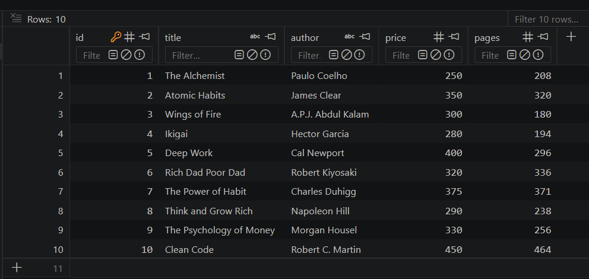


## 6. Installation and Setup

### Prerequisites

* Node.js installed.
* VS Code or another code editor.
* Postman installed.
* SQLite database.

### Step 1: Clone the Repository

```bash
git clone https://github.com/hemkesh08/Hemkesh---Lab-Report---3.git
```

### Step 2: Navigate to the Project Directory

```bash
cd Hemkesh---Lab-Report---3
```

### Step 3: Install Dependencies

```bash
npm install
```

### Step 4: Start the Server

```bash
node server.js
```

The server starts on port 3000 by default.

```text
http://localhost:3000
```

## 7. API Endpoints

Base URL:

```text
http://localhost:3000
```

### 7.1 GET – Retrieve All Books

**Endpoint:**

```http
GET /books/
```

Retrieves all books from the database.

**Screenshot:**

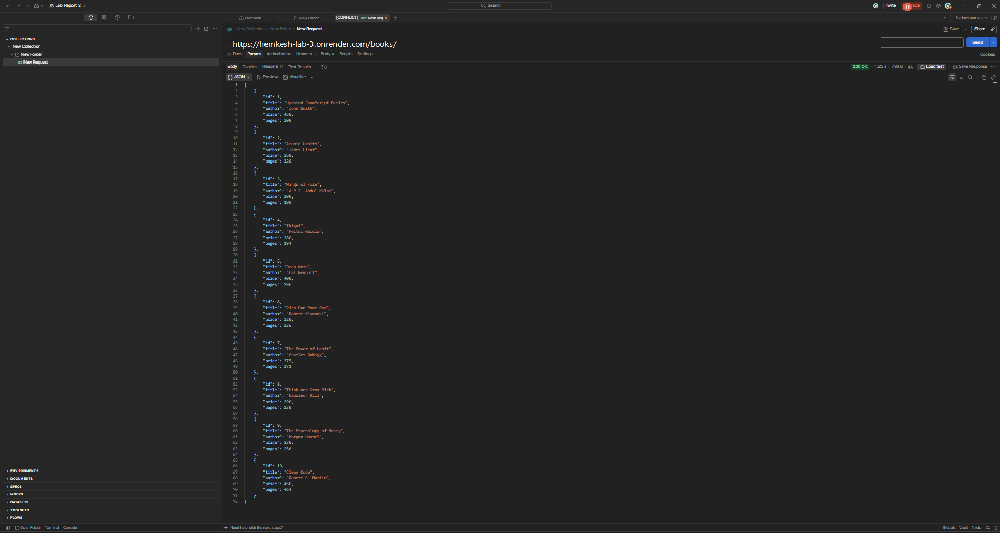


### 7.2 GET – Retrieve Book by ID

**Endpoint:**

```http
GET /books/:bookId/
```

Retrieves a specific book using its ID.

**Screenshot:**

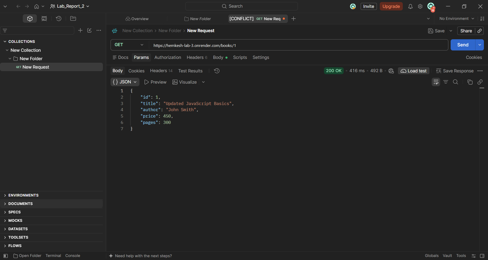


### 7.3 GET – Search Books

**Endpoint:**

```http
GET /books/?search_q=power
```

Searches for books using a partial title match with the SQL LIKE operator.

**Screenshot:**

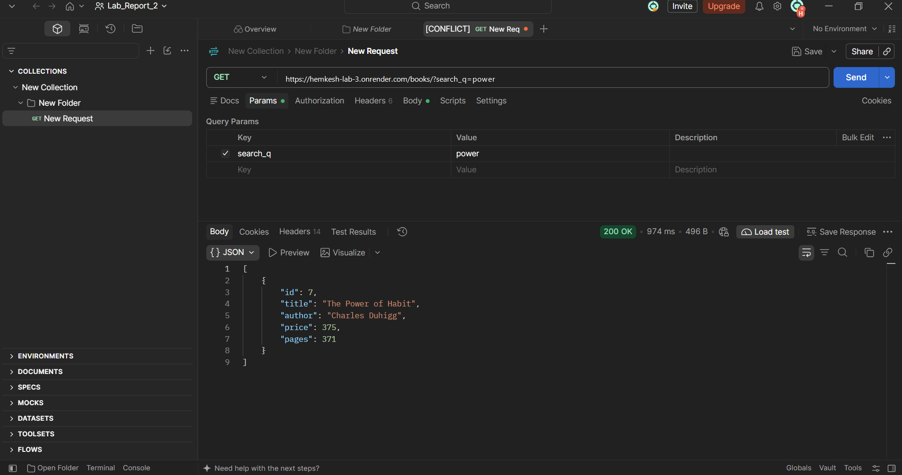


### 7.4 GET – Sort Books

**Endpoint:**

```http
GET /books/?order_by=price&order=ASC
```

Sorts books using the selected column and sorting order.

Supported sorting orders:

* ASC – Ascending order.
* DESC – Descending order.

**Screenshot:**

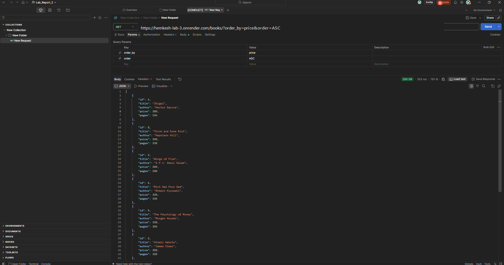


### 7.5 GET – Pagination

**Endpoint:**

```http
GET /books/?limit=3&offset=2
```

Uses limit and offset to retrieve a specific number of records.

* `limit` specifies the maximum number of books.
* `offset` specifies the number of records to skip.

**Screenshot:**

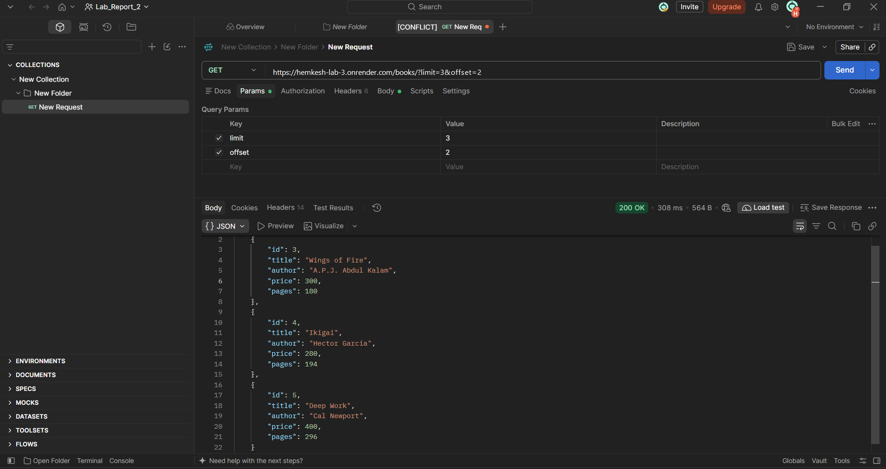


### 7.6 GET – Price Range Filtering

**Endpoint:**

```http
GET /books/?min_price=300&max_price=400
```

Filters books based on minimum and maximum price values.

**Screenshot:**

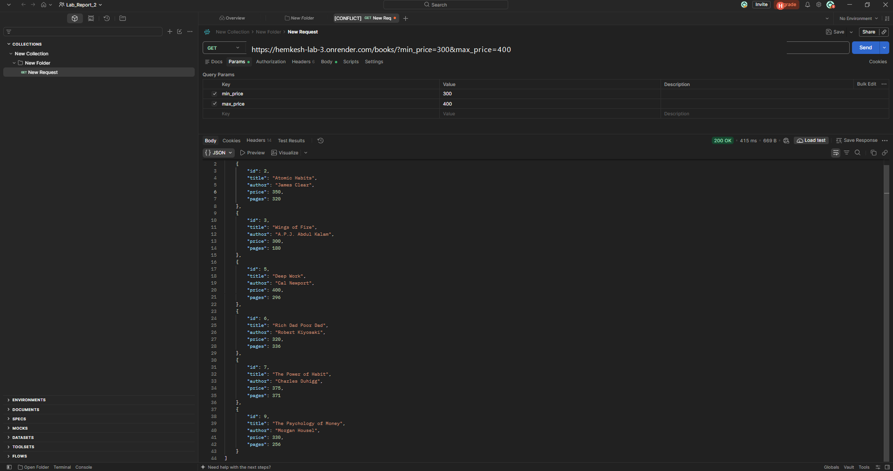


### 7.7 POST – Add a New Book

**Endpoint:**

```http
POST /books/
```

Adds a new book to the database.

**Sample JSON Request:**

```json
{
  "title": "The Pragmatic Programmer",
  "author": "Andrew Hunt",
  "price": 450,
  "pages": 352
}
```

**Expected Status Code:** `201 Created`

**Screenshot:**

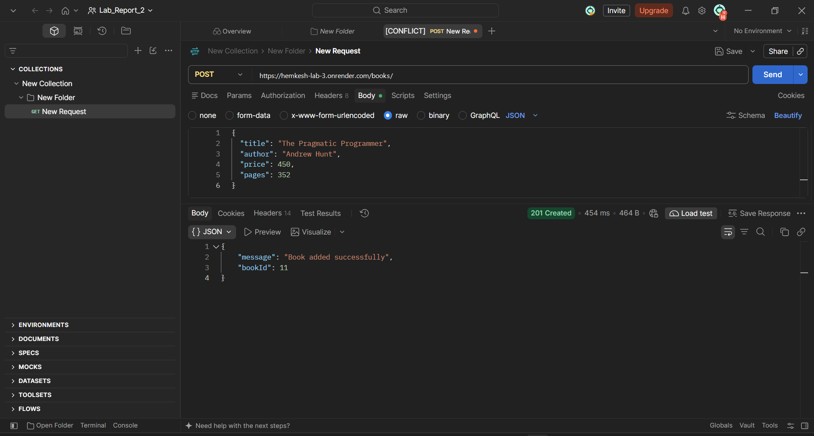


### 7.8 POST – Request Validation

The API validates incoming request data.

It rejects:

* Missing title.
* Missing author.
* Non-numeric price.
* Invalid or negative price.

**Expected Status Code:** `400 Bad Request`

**Screenshot:**

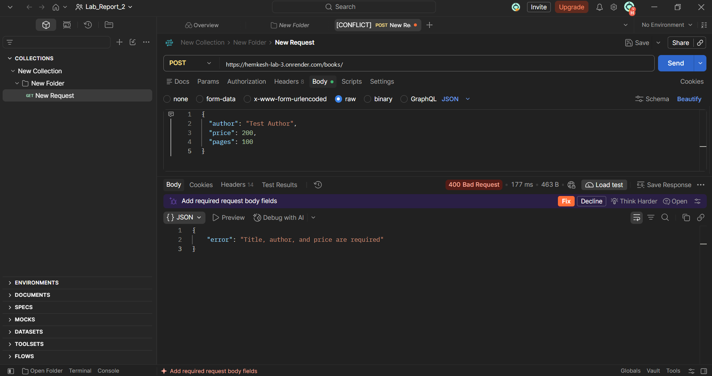


### 7.9 PUT – Update an Existing Book

**Endpoint:**

```http
PUT /books/:bookId/
```

Updates the details of an existing book.

**Sample JSON Request:**

```json
{
  "title": "Updated Book",
  "author": "Updated Author",
  "price": 500,
  "pages": 250
}
```

**Expected Status Code:** `200 OK`

**Screenshot:**


### 7.10 PUT – Book Not Found

When the requested book ID does not exist, the API returns:

**Expected Status Code:** `404 Not Found`

**Screenshot:**

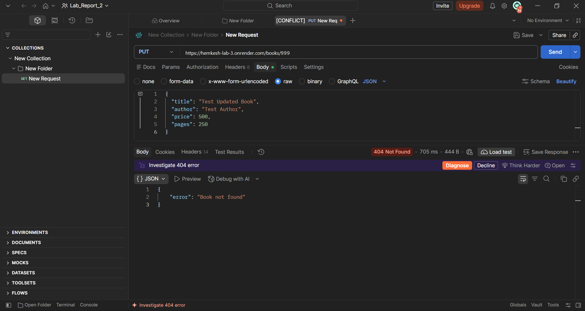


### 7.11 DELETE – Delete a Book

**Endpoint:**

```http
DELETE /books/:bookId/
```

Deletes a book from the database using its ID.

**Expected Status Code:** `200 OK`

**Screenshot:**

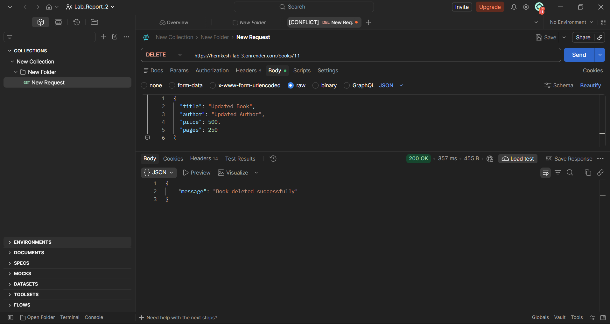


### 7.12 DELETE – Book Not Found

When the requested book ID does not exist, the API returns:

**Expected Status Code:** `404 Not Found`

**Screenshot:**

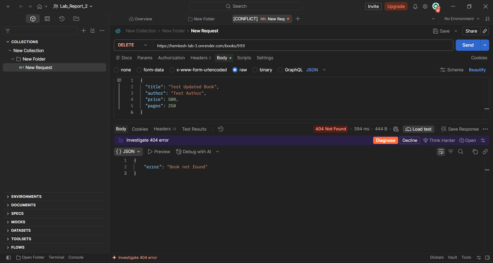


## 8. Debugging Exercises

During the development of the REST API, the following common Node.js and database errors were studied along with their solutions.

### 1. EADDRINUSE – Port Conflict

**Problem:** This error occurs when another application is already using the same port.

**Solution:** Stop the existing server process or use another available port. The application uses `process.env.PORT || 3000` to configure the server port.

### 2. Wrong Import Path

**Problem:** Node.js cannot find a required module when the import path or filename is incorrect.

**Solution:** Verify the file name, directory path and spelling in the `require()` statement.

### 3. SQLITE_ERROR: no such table

**Problem:** This error occurs when an SQL query refers to a table that does not exist or uses an incorrect table name.

**Solution:** Verify the database file, table name and SQL query. In this project, the table name is `book`.

### 4. Missing await

**Problem:** Without `await`, an asynchronous database operation returns a Promise instead of the actual query result.

**Solution:** Use `await` with asynchronous database operations such as `db.all()`, `db.get()` and `db.run()` to retrieve their results before sending the response.

## 9. HTTP Status Codes Used

| Status Code               | Description                              |
| ------------------------- | ---------------------------------------- |
| 200 OK                    | Request completed successfully           |
| 201 Created               | New book successfully created            |
| 400 Bad Request           | Invalid request data or query parameters |
| 404 Not Found             | Requested book ID does not exist         |
| 500 Internal Server Error | Unexpected server or database error      |

## 10. SQL Query Handling

Parameterized SQL queries are used for database operations.

Examples include:

* `db.all()` – Retrieve multiple book records.
* `db.get()` – Retrieve a single book record.
* `db.run()` – Insert, update and delete book records.

Using parameterized queries helps prevent SQL injection by separating user input from SQL commands.

## 11. Deployment

The application is deployed using Render.

**Live Application:**

https://hemkesh-lab-3.onrender.com/

**GitHub Repository:**

https://github.com/hemkesh08/Hemkesh---Lab-Report---3

## 12. Testing

The API was tested using Postman.

The following operations were tested:

* Retrieve all books.
* Retrieve a book by ID.
* Search books by title.
* Sort books in ascending and descending order.
* Retrieve books using pagination.
* Filter books using minimum and maximum prices.
* Add a new book.
* Validate POST request data.
* Update an existing book.
* Handle updates for non-existing book IDs.
* Delete an existing book.
* Handle deletion for non-existing book IDs.

Both successful and failure scenarios were tested to verify the API responses and HTTP status codes.

## 13. Conclusion

Through this lab, I gained practical experience in developing RESTful APIs using Node.js, Express.js and SQLite.

I learned how to implement query parameters, search, sorting, pagination and price-range filtering. I also understood the importance of request validation, parameterized SQL queries, asynchronous database operations and appropriate HTTP status codes.

Additionally, I studied common debugging problems related to port conflicts, incorrect import paths, database table errors and missing await statements.

This lab improved my understanding of backend API development, database integration, API testing and application deployment.
